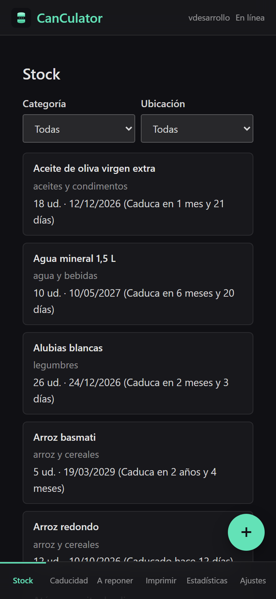
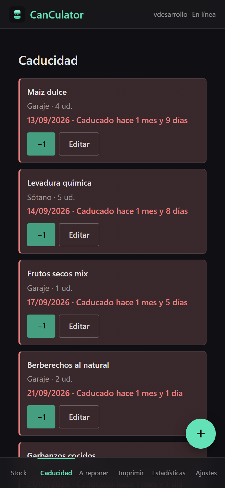
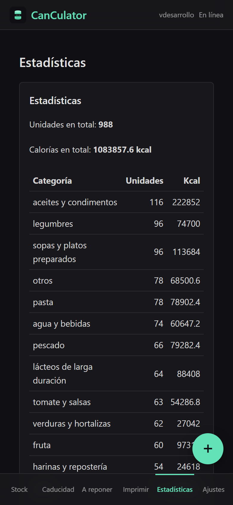
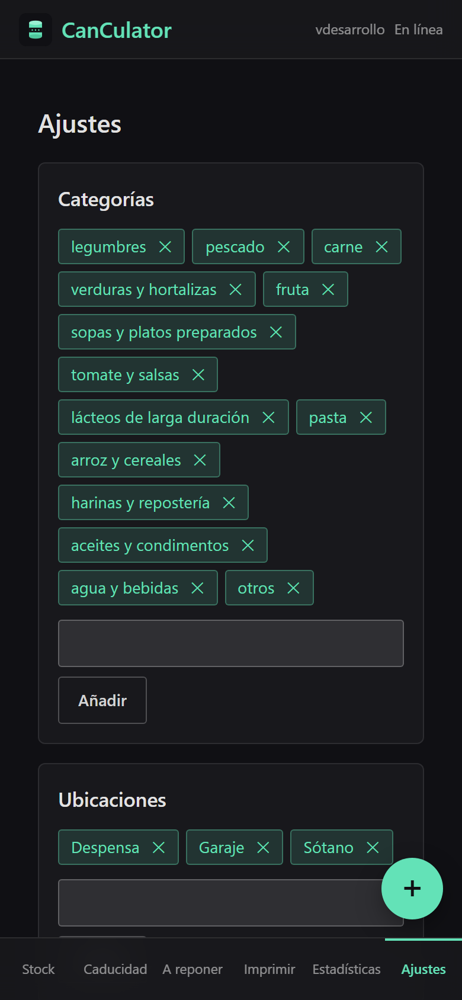
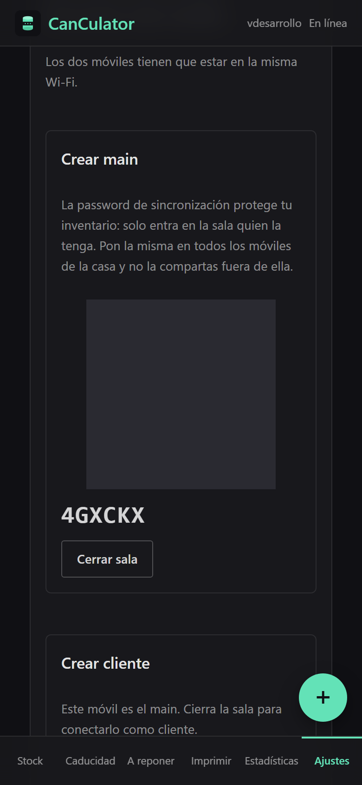
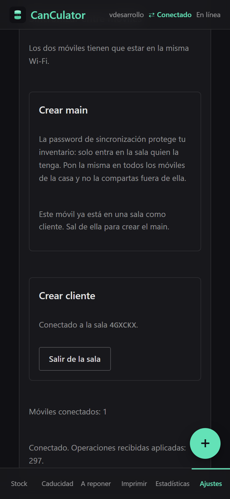

# CanCulator

CanCulator is an installable web app (PWA) that keeps track of the non-perishable food at home: what you have,
where it is, when it expires and what you need to buy. It works offline, and the phones in the house
can sync with each other over the same Wi-Fi.

Live app: https://ramon-balaguer.github.io/canculator/

The interface is in Spanish. This README is in English.

## Screenshots

These screenshots use a demo inventory: 65 products, 170 lots, 16 photos and about 300 recorded operations.

| Stock | Expiry (Caducidad) | Statistics |
| :---: | :---: | :---: |
|  |  |  |

| Settings: categories and locations | Sync: main phone | Sync: client phone |
| :---: | :---: | :---: |
|  |  |  |

## Screens

- **Stock**: every lot grouped by product, with filters by category and location.
- **Caducidad** (expiry): lots sorted by expiry date. Lots that expire soon or have expired are highlighted.
  Use **−1** to consume one unit, or **Editar** to change the lot.
- **A reponer** (restock): products whose stock is below their minimum. **Comprado** (bought) opens a new lot
  with the product already filled in.
- **Imprimir** (print): a printable table of the lots, opened with the browser's print dialog. Save as PDF works too.
- **Estadísticas** (statistics): total units and calories, and a table by category.
- **Ajustes** (settings): categories, locations, sync between phones, install button, app version,
  diagnostics pages, and JSON backup (export and import).
- **+** button: add a lot. Type the product name, or scan its barcode with the camera. When the barcode is
  in Open Food Facts, the name, category and nutrition data are filled in automatically. Each product can have
  a photo and notes.

## Sync between phones

Two phones in the same house share one inventory. Each change made on one phone (a new lot, a unit consumed,
an edit, a category added) is sent to the other phone right away. If a phone is offline, its changes wait in a
queue and are sent as soon as it connects again.

### Concepts

- **Main**: the phone that creates the room. Any phone can be the main, but only one phone creates the room.
- **Client**: the phone that joins the room of the main.
- **Password de sincronización** (sync password): a password you choose. Only phones that know it can join the
  room. Use the same password on every phone in the house.
- **Room code**: six characters (for example `XFJ2F2`) that the main shows on its screen. The QR code shows the
  same code and the password, so scanning it fills in both fields.
- **Requirements**: both phones must be on the same Wi-Fi network and have internet access. The phones find each
  other through the public PeerJS signalling service, and the inventory data is then sent directly between the
  phones over WebRTC.

### Step by step

**1. On the main phone**

1. Open **Ajustes** and go to **Sincronizar entre móviles** → **Crear main**.
2. Type the sync password (for example, `my-house-2026`).
3. Tap **Guardar y crear sala** (save and create room).
4. The screen now shows a QR code and a six-character room code. Leave the app open.

**2. On the client phone**

1. Open **Ajustes** → **Crear cliente** → **Escanear QR**.
2. Point the camera at the QR code on the main phone. The password and the code fill in automatically.
   If you cannot scan it, type the room code yourself and type the same password.
3. Tap **Guardar** (save).
4. The client joins the room. Its screen shows **Conectado a la sala** with the code.

**3. Check that it works**

- Both phones show **⇄ Conectado** in the top bar, and the main shows **Móviles conectados: 1**.
- Add a lot on one phone. It appears on the other one without doing anything else.
- Put both phones in airplane mode, consume one unit of the same lot on each, then turn the connection back on.
  The lot goes down by two on both phones.

### Things to know

- **The room is restored automatically.** When you open the app again, a main re-opens its room and a client
  connects back to it. You do not need to repeat the steps.
- **If the main is not open, the client waits.** The client retries every second until the main is back.
  The main can take a few seconds to show again after it restarts, because the room code has to be released first.
- **Closing a room:** the main taps **Cerrar sala** (close room). The client taps **Salir de la sala** (leave room).
  Each phone keeps its own copy of the data after leaving.
- **Only a phone outside a room can create one.** A phone that is already a client must leave the room before it
  can become a main, and the other way around.
- **The password is the only lock.** Anyone with the password can join the room and read or change the inventory.
  Do not post the QR code or the password outside the house. The QR code contains the password.
- **Changes do not get lost.** Changes made while offline are sent when the phones connect. If the same record was
  changed on both phones, the most recent change wins.
- **Photos travel too.** A phone asks the other one for the photos it is missing, one by one.
- **Settings are synced.** Categories and locations are shared between phones. The local app settings, such as
  the stored sync password, are not.

### If the phones do not connect

| Message | What to do |
| :--- | :--- |
| *Los móviles no tienen el mismo token: no se sincroniza.* | The passwords differ. Enter the same password on both phones. |
| *La sala aún no está disponible; reintentando…* | The main is not open yet. Open the app on the main phone and wait. |
| *La sala aún está activa en el servicio; reintentando…* | The room code is still registered after a restart. Wait a few seconds. |
| *Error de la sala* or *No se pudo unir* | Check that both phones have internet access. Close the room and create it again. |
| *La conexión se ha cerrado.* | The client retries by itself. If it does not connect, check the Wi-Fi network. |

For a step-by-step test on real phones, see [`docs/mobile-checklist.md`](docs/mobile-checklist.md) (in Spanish).
The **Prueba de sala P2P** page under **Ajustes → Diagnóstico** helps when a connection fails.

## Data

Inventory data lives on each phone, in IndexedDB. It is never stored in this repository, which is public.

- **Backup:** **Ajustes → Copia de seguridad → Exportar JSON** downloads a copy of the inventory, photos included.
- **Restore:** **Importar JSON** merges a copy with the data already on the phone. The most recent version of each
  record wins, so importing the same file twice does not duplicate anything.
- **Alert settings:** the days before "caduca pronto" (expires soon), the daily reminder time and the reminder
  email addresses are saved in the settings. This version does not send any reminders or emails yet.

## Development

The app has no build step. It uses native HTML, CSS and JavaScript modules. The interface uses Preact and htm
(templates as text, no JSX), and barcode reading uses ZXing. `npm run vendor` copies their browser builds into
`vendor/`, which is not committed, and an import map links them.

```bash
npm install
npx playwright install chromium webkit
npm run servir      # http://localhost:4173/inventario/
npm test            # unit tests (node --test) and end-to-end tests (Playwright)
```

Other scripts:

- `npm run test:unit`: unit tests only. They live in `tests/unit/`.
- `npm run test:e2e`: browser tests only. They live in `tests/e2e/`.
- `npm run construir`: builds `_site/` for GitHub Pages, injecting the commit version into `sw.js`.

### Project layout

- `js/logica/`: business rules with no DOM access. These are tested with `node --test`.
- `js/datos/`: IndexedDB, photos, backups, the sync link (`peer-link.js`) and Open Food Facts (`off.js`, with a cache).
- `js/ui/`: the screens and components.
- `js/logica/peer-sync.js` and `js/datos/peer-link.js`: sync between phones, with a conflict rule and an operations queue.
- `sw.js`: the service worker. It tries the network first and falls back to the cache when there is no connection
  or the network takes longer than 4 seconds.
- `camera-test.html`: camera and barcode diagnostics on the phone.
- `scripts/`: the local server, the build, and the vendor copy.
- `docs/mobile-checklist.md`: manual checks on Android and iPhone, by phase.

### Workflow for changes

These rules apply to every change (see [`CLAUDE.md`](CLAUDE.md)):

1. **Test first (TDD).** Write a failing test before the code. Unit tests go in `tests/unit/`. If the change affects
   what the user sees, add an end-to-end test in `tests/e2e/`. Run it and check that it fails for the right reason.
   Then write the code until the test passes.
2. **Run both suites** (`npm run test:unit` and `npm run test:e2e`) before delivering.
3. **One branch per change.** Create a new branch from `main`. Never work directly on the branch you are on.
4. **Commit, push and open a pull request.** The pull request runs the same tests in CI.
5. **Merge into `main`.** A push to `main` runs the tests again and, if they pass, deploys to GitHub Pages
   (`.github/workflows/deploy.yml`).
6. **Clean up.** Delete the branch locally and on the remote.

## License

Private project. All rights reserved.
